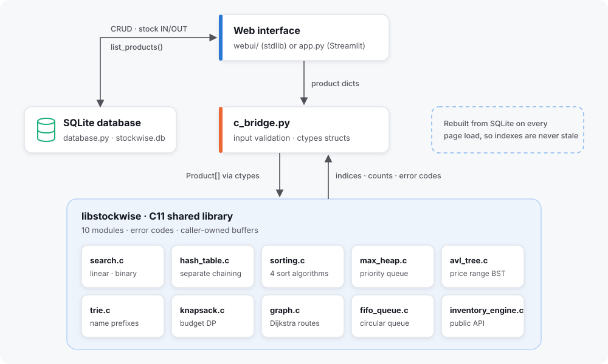
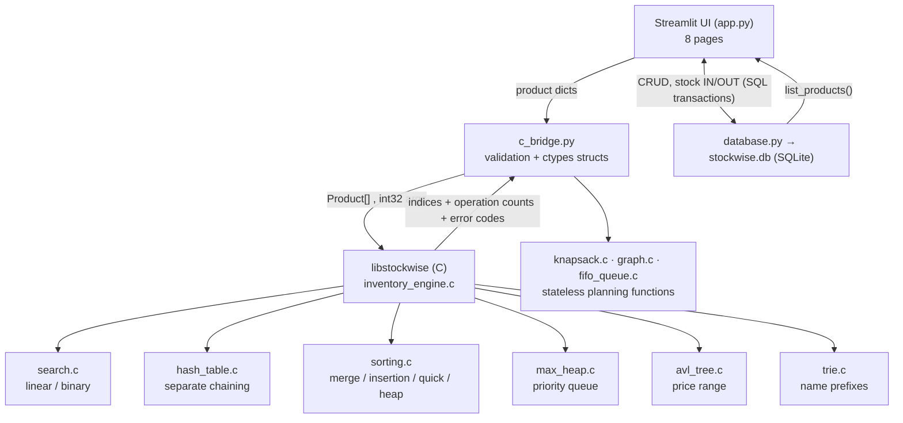

# StockWise: Inventory Optimization System Using DSA

A college Data Structures & Algorithms project. The interface is **Python + Streamlit**.
The core algorithms are implemented from scratch in **C11** and compiled into a shared
library that Python calls through **ctypes**:

| Concept (C) | File | Feature in the app |
|---|---|---|
| Linear and binary search | `search.c` | ID search comparison |
| Hash table, separate chaining | `hash_table.c` | Product lookup by ID |
| Merge, Insertion, Quick, Heap Sort | `sorting.c` | Sorted product views |
| Max-Heap priority queue | `max_heap.c` | Restock ranking |
| AVL tree (self-balancing BST) | `avl_tree.c` | Price range filter |
| Trie (prefix tree) | `trie.c` | Name autocomplete |
| 0/1 Knapsack, dynamic programming (+ greedy) | `knapsack.c` | Budget restock planner |
| Graph + Dijkstra shortest path | `graph.c` | Delivery route planner |
| Circular FIFO queue (ring buffer) | `fifo_queue.c` | Stock lots and stock age |

**SQLite** stores products and stock transactions.

| Layer | Technology | Files |
|---|---|---|
| Frontend | Python 3.9+, Streamlit, Plotly | `app.py` |
| Python ↔ C bridge | `ctypes` | `c_bridge.py` |
| DSA engine | C11, GCC/Clang | `backend/*.c`, `backend/inventory_types.h`, `backend/Makefile` |
| Persistence | SQLite (Python `sqlite3`) | `database.py`, `schema.sql` |
| Tests | C test program, Python `unittest` | `backend/tests/test_engine.c`, `tests/` |

More documents:
- [`docs/ALGORITHMS.md`](docs/ALGORITHMS.md): pseudocode, complexity table, priority formula
- [`docs/REPORT_AND_VIVA.md`](docs/REPORT_AND_VIVA.md): college report outline and viva questions with answers

---

## 1. Architecture





### Python ↔ C communication flow

1. `database.list_products()` reads every product from SQLite. SQLite is the single
   source of truth.
2. `c_bridge.Engine(products)` validates each record and packs it into a ctypes
   `CProduct` array (layout identical to the C `Product` struct). It then calls
   `sw_engine_create()`.
3. The C engine **copies** the array and builds its indexes:
   - a **hash table**, which also rejects duplicate IDs
   - an **id-sorted index** with Merge Sort, for binary search
   - an **AVL tree** by price
   - a **trie** of name word starts
   The planning functions (knapsack, Dijkstra, FIFO lots) are stateless. Python passes
   in arrays and gets results back.
4. The UI calls e.g. `engine.binary_search(1042)`. C fills a `SearchResult`
   (index, found flag, comparisons) in a buffer that Python owns, and Python maps the
   index back to the product dict.
5. `Engine.close()` (or the `with` block) calls `sw_engine_destroy()`, which frees all
   C memory.
6. The app rebuilds the engine from SQLite on **every page load**. After any add, edit,
   delete or stock change, the C indexes can never be stale.

The C engine never stores inventory itself; it is a read-only snapshot used for DSA work.

### C API (declared in `backend/inventory_types.h`)

| Function | Purpose |
|---|---|
| `sw_engine_create(products, count, bucket_count, &err)` | Copy products, build hash table + id index. `bucket_count <= 0` = auto (prime ≥ 2n) |
| `sw_engine_destroy(engine)` | Free everything (NULL-safe) |
| `sw_linear_search_id`, `sw_binary_search_id`, `sw_hash_search_id` | Search by ID → `SearchResult` |
| `sw_linear_search_name` | Case-insensitive substring search |
| `sw_sort_products(engine, algorithm, key, descending, out, cap, &stats)` | Merge/Insertion/Quick/Heap sort by name, price, quantity, value |
| `sw_price_range`, `sw_avl_snapshot`, `sw_index_stats` | AVL range query, tree shape, tree and trie statistics |
| `sw_prefix_search` | Trie autocomplete (alphabetical, de-duplicated) |
| `sw_knapsack`, `sw_knapsack_greedy` | Budget plan: exact DP (optional DP table) vs greedy |
| `sw_shortest_path` | Dijkstra: distances to every node + route to the target |
| `sw_fifo_lots` | Replay stock moves through a circular queue → lots on hand |
| `sw_restock_ranking(engine, out, cap, &count, heap_snapshot, &stats)` | Max-Heap priority ranking |
| `sw_hash_stats`, `sw_hash_chain_lengths` | Buckets, collisions, chain lengths |
| `sw_error_message(code)` | Static message string for an error code |

**Ownership rules:**
- The caller allocates every output buffer. Index and RestockItem buffers must hold at
  least `count` elements; a shorter buffer returns `SW_ERR_BUFFER_TOO_SMALL`.
- The engine owns its copy of the data.
- No function returns a pointer to a local variable. `sw_error_message` returns string
  literals.

**Error codes:**

| Code | Name |
|---|---|
| 0 | `SW_OK` |
| -1 | `NULL_POINTER` |
| -2 | `INVALID_LENGTH` |
| -3 | `INVALID_VALUE` |
| -4 | `DUPLICATE_ID` |
| -5 | `NOT_FOUND` |
| -6 | `NO_MEMORY` |
| -7 | `BUFFER_TOO_SMALL` |

---

## 2. Setup

### Linux (Ubuntu/Debian)

```bash
sudo apt update && sudo apt install -y build-essential python3 python3-pip python3-venv
git clone <your-repo-url> StockWise-Dsa && cd StockWise-Dsa
python3 -m venv .venv && source .venv/bin/activate
pip install -r requirements.txt
cd backend && make && make test && cd ..      # builds backend/libstockwise.so
streamlit run app.py
```

On macOS, use `xcode-select --install` for the compiler. `make` builds `libstockwise.dylib`.

### Windows 10/11

1. Install **64-bit Python 3.9+** from python.org. Tick "Add python.exe to PATH".
2. Install GCC through **MSYS2**:
   - Download it from https://www.msys2.org and install it to `C:\msys64`.
   - Open the *MSYS2 UCRT64* terminal and run:
     ```
     pacman -S --needed mingw-w64-ucrt-x86_64-gcc mingw-w64-ucrt-x86_64-make
     ```
   - Add `C:\msys64\ucrt64\bin` to your Windows **PATH**.
   - Open a new terminal and check with `gcc --version`.
3. In **Command Prompt** (cmd.exe), from the project folder:
   ```bat
   python -m venv .venv
   .venv\Scripts\activate
   pip install -r requirements.txt
   cd backend
   mingw32-make
   mingw32-make test
   cd ..
   streamlit run app.py
   ```
   `mingw32-make` builds `backend\stockwise.dll`. Without make, you can build it
   directly:
   ```bat
   gcc -std=c11 -O2 -Wall -shared -static-libgcc -o stockwise.dll search.c hash_table.c sorting.c max_heap.c avl_tree.c trie.c knapsack.c graph.c fifo_queue.c inventory_engine.c
   ```

Python and GCC must both be 64-bit. A 32-bit DLL cannot be loaded by 64-bit Python.

To use a library somewhere else, set the environment variable `STOCKWISE_LIB` to its
full path. To use another database file, set `STOCKWISE_DB`.

The first run creates `stockwise.db` with 25 realistic sample products and about 90 days
of backdated deliveries and sales, so the charts and stock-age views have data to show.
Delete the file to reset the data.

---

## 3. Testing

```bash
cd backend && make test && cd ..                 # C tests (283 checks)
python -m unittest discover -s tests -v          # Python tests (bridge + SQLite)
```

| Area | Where |
|---|---|
| Linear/binary/hash search, missing keys, comparison counts | `test_engine.c::test_searches`, `test_c_bridge.py::SearchTests` |
| Hash collisions (3 buckets, chain of 4) | `test_engine.c::test_hash_collisions`, `HashAndHeapTests` |
| Merge/Insertion Sort, stability, best/worst-case counts | `test_engine.c::test_sorting`, `SortTests` (compared against Python `sorted`) |
| Max-Heap property, extraction order, ties, overflow | `test_engine.c::test_heap`, `test_restock` |
| Empty arrays, NULL pointers, duplicate IDs, invalid values | `test_engine.c::test_empty_and_invalid`, `EmptyAndInvalidTests` |
| Invalid price/quantity, insufficient stock, persistence, cascade delete | `test_database.py` |
| C index refreshed after DB change | `test_database.py::test_engine_rebuilt_after_change_is_not_stale` |
| Quick/Heap Sort with many duplicate keys and sorted input | `test_engine.c::test_quick_and_heap_sort`, `NewStructureTests` |
| AVL balance and BST order (1,000 ascending inserts), range queries vs brute force | `test_engine.c::test_avl`, `test_price_range_matches_brute_force` |
| Trie prefixes, word starts, de-duplication | `test_engine.c::test_trie`, `test_prefix_search` |
| Knapsack DP optimal vs brute force (20 random cases), greedy shortfall | `test_engine.c::test_knapsack`, `test_knapsack_against_brute_force` |
| Dijkstra paths, unreachable nodes, invalid edges | `test_engine.c::test_graph`, `test_shortest_path` |
| FIFO queue wrap-around and growth, over-removal | `test_engine.c::test_fifo`, `test_fifo_lots` |
| Seeded history consistent and matched by the C FIFO queue | `test_database.py::test_seeded_history_ends_at_listed_quantities` |

The C tests were also run under AddressSanitizer and UndefinedBehaviorSanitizer:

```bash
cd backend
gcc -std=c11 -g -fsanitize=address,undefined -I. -o t tests/test_engine.c search.c hash_table.c sorting.c max_heap.c avl_tree.c trie.c knapsack.c graph.c fifo_queue.c inventory_engine.c -lm
./t
```

The **DSA Lab → Edge cases** tab runs the same kinds of checks live in the app and
shows pass or fail for each one.

---

## 4. Database schema (`schema.sql`)

- **products**:
  - `id` INTEGER PK (> 0)
  - `name` and `category` (non-empty)
  - `price` (≥ 0), `quantity` (≥ 0), `min_stock` (≥ 0)
  - `demand` (≥ 0 or NULL), `importance` (1–5 or NULL)
  - `created_at`, `updated_at`
- **inventory_transactions**:
  - `id` PK
  - `product_id` FK → products (ON DELETE CASCADE)
  - `type` IN/OUT
  - `quantity` (> 0), `balance_after` (≥ 0)
  - `note`, `created_at`

Consistency rules:
- Every query is parameterized.
- A stock change is an `UPDATE … WHERE quantity + delta >= 0` plus an `INSERT` into
  history, both inside one SQLite transaction. Either both happen or neither does, and
  stock can never go negative.
- Editing a product cannot change its quantity. All stock changes go through
  transactions, so history always explains the current balance.

---

## 5. Application pages

Design notes:
- **Navigation.** A sidebar with three groups (Overview, Inventory, Algorithms) and
  [Material Symbols](https://fonts.google.com/icons) icons. The UI uses no emoji.
- **Theme.** Set in `.streamlit/config.toml`: Inter typeface, blue `#2a78d6` primary,
  10px radii.
- **Charts.** All charts share one validated, colorblind-safe palette (blue, orange,
  aqua), with hover tooltips and direct labels.
- **Artwork.** The logo, dashboard banner, empty states and architecture diagram are
  SVG files in `assets/`.
- **Status.** Stock status always appears as an icon plus a text label, never color
  alone.

1. **Dashboard**:
   - KPIs, with a 30-day stock sparkline
   - stock movement chart
   - "needs attention" list (Max-Heap)
   - value by category, top products (Merge Sort)
   - recent transactions
2. **Products**:
   - card grid with category artwork, or a table view
   - search by ID (hash table) or name prefix (trie, with substring fallback)
   - price range filter (AVL tree)
   - add, edit, and delete with confirmation
3. **Transactions**:
   - stock IN/OUT with validation, and history
   - FIFO stock lots and stock age (circular queue)
4. **Restocking**:
   - Max-Heap ranking and score breakdown
   - budget planner: knapsack DP vs greedy, and one click to order the plan
5. **Delivery routes**: Dijkstra shortest route on a map of the warehouse and 7
   branches.
6. **Search and sorting**: every search structure and all four sorts, with operation
   counts.
7. **DSA laboratory**:
   - real or generated data
   - hash collisions
   - heap, AVL tree and trie views
   - sort scaling chart
   - editable knapsack DP table
   - live edge cases, pseudocode
8. **About**: architecture diagram and complexity table.

## 6. Project structure

```
StockWise-Dsa/
├── app.py                 Streamlit frontend
├── c_bridge.py            ctypes wrapper
├── database.py            SQLite access layer + sample data
├── schema.sql             database schema
├── requirements.txt
├── .streamlit/config.toml theme: colors, Inter font, radii, sidebar
├── assets/                logo, hero banner, empty state, architecture, categories/ (SVG)
├── backend/
│   ├── inventory_types.h  structs, constants, API declarations
│   ├── search.c           linear + binary search
│   ├── hash_table.c       separate-chaining hash table
│   ├── sorting.c          merge, insertion, quick, heap sort
│   ├── max_heap.c         max-heap priority queue
│   ├── avl_tree.c         AVL tree, price range queries
│   ├── trie.c             trie, name prefix search
│   ├── knapsack.c         0/1 knapsack DP + greedy
│   ├── graph.c            Dijkstra shortest path
│   ├── fifo_queue.c       circular queue, FIFO stock lots
│   ├── inventory_engine.c public API used by Python
│   ├── Makefile
│   └── tests/test_engine.c
├── tests/
│   ├── test_c_bridge.py
│   └── test_database.py
└── docs/
    ├── ALGORITHMS.md
    └── REPORT_AND_VIVA.md
```
